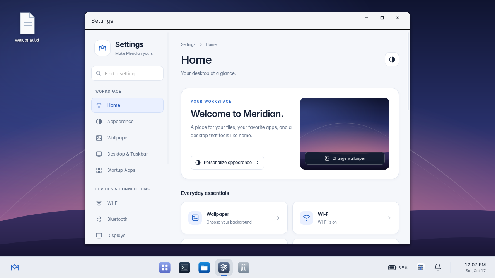
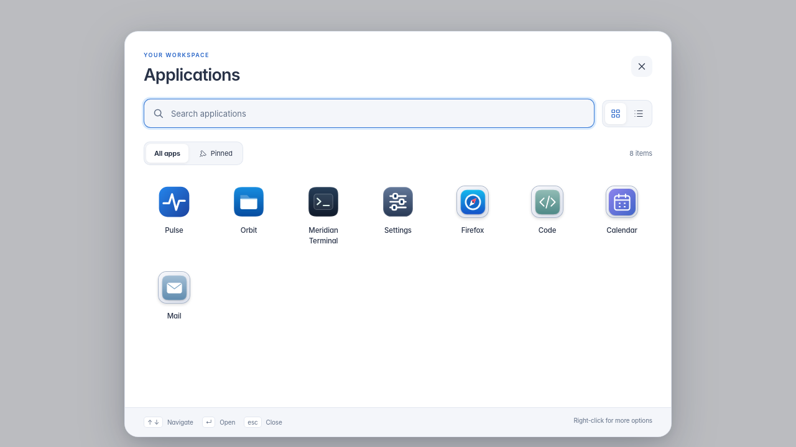
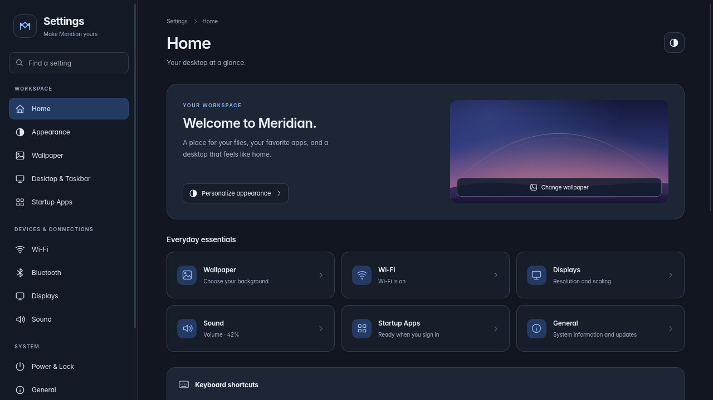
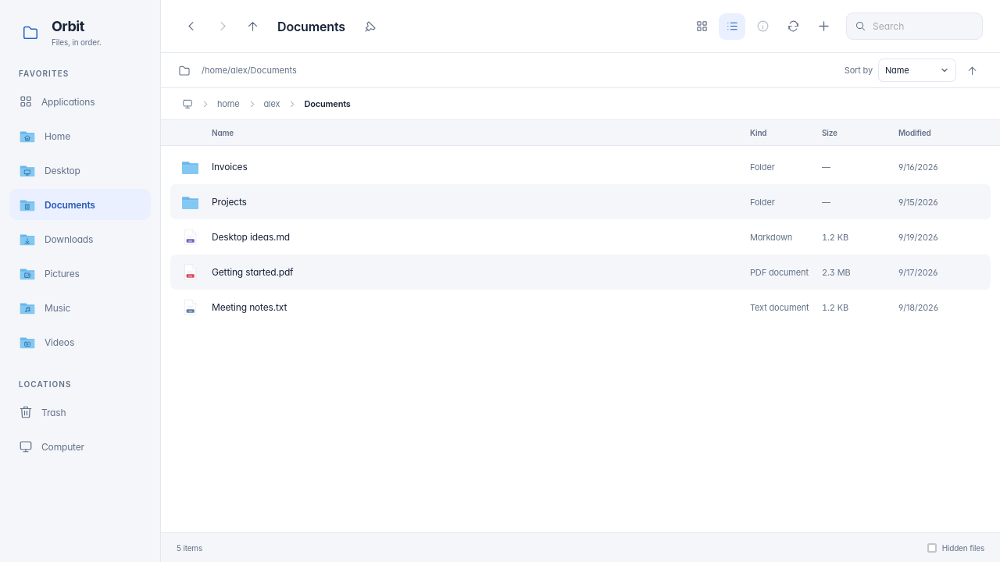
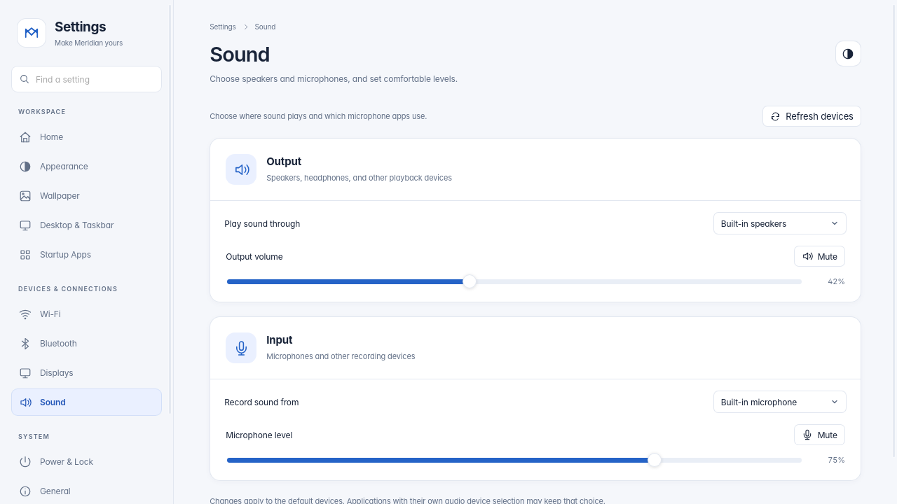

# Meridian

A Linux desktop shell with a Windows-style bottom taskbar, searchable application
launcher, Control Center, desktop shortcuts, and built-in Orbit, Terminal,
and Settings windows.

Meridian runs on labwc/Wayland and existing Linux services. Its native host is
written in Rust; React, TypeScript, HTML, and CSS provide the interface inside
WebKitGTK. GTK4 hosts the web surfaces and native window controls.

**Status:** working prototype. The [0.2 stability qualification](docs/PHASE1.md) tracks automated coverage and the remaining hardware release gates. [0.3 performance work](docs/PHASE2.md) records optimization changes, measurements and qualification gaps. [0.8 workflow work](docs/PHASE3.md) tracks the initial desktop improvements and remaining Public Beta work. Wallpaper, appearance, networking, Bluetooth,
display configuration, file operations, and terminal sessions are implemented.
Some settings remain placeholders, and Sharing is a UI-only prototype.
See [the architecture](docs/ARCHITECTURE.md) for implementation details and limits.

## Screenshots

Meridian running on Wayland, with Settings and the bottom taskbar:



| Applications | Settings in dark mode |
| --- | --- |
| [](docs/previews/modern-launcher-light.png) | [](docs/previews/modern-settings-dark.png) |
| **Orbit file manager** | **Sound settings** |
| [](docs/previews/modern-orbit-light.png) | [](docs/previews/modern-sound-light.png) |

The desktop capture uses an isolated native session; the gallery previews use
sample data. Click an image to view it at full size, or see [more screenshots and capture details](docs/previews/README.md).

## Debian requirements

The current checkout needs Rust >= 1.92, GTK >= 4.18, WebKitGTK >= 2.52, gtk4-layer-shell >= 1.2, and Node >= 22.22.2. Development and CI target Debian testing with matching packages; Debian derivatives with those versions also work. Older stable releases need compatible backports; the scripts do not change your APT sources. Development dependencies are installed directly on the host.

## Try it

```sh
tools/dev-env.sh        # one-time: install Debian development packages on the host
tools/dev-session.sh    # build and run Meridian in a nested window
tools/dev-greeter.sh    # try the login screen in a window (fake login, password "meridian")
tools/check.sh          # fmt, clippy, tests, UI type-check
```

## Install (Debian)

```sh
tools/build-release.sh                       # as your user
sudo tools/install.sh                        # adds "Meridian" to your login screen's session list
sudo tools/install.sh --try-login-screen     # optional: Meridian's login screen on Ctrl+Alt+F7
sudo tools/install.sh --enable-login-screen  # optional: make it your login screen (after reboot)
sudo tools/install.sh --disable-login-screen # undo the above
sudo tools/install.sh --uninstall
```

For updates, run `tools/build-release.sh` before `sudo tools/install.sh`, then
sign out of Meridian and back in. The installer verifies that the release
binaries and UI match the current sources; it rejects stale or mixed builds.
Use `tools/install.sh --check-build` to check this without root or installation.

| Keys | Action |
|---|---|
| Super / Super+Space | Applications menu (type to search, ↑ ↓, Enter, Esc) |
| Super+C | Control Center |
| Super+E | Orbit |
| Super+I | Settings |
| Super+Enter | Terminal |
| Super+L | Lock |
| Print Screen | Save a screenshot of the desktop |
| Super+Shift+S / Shift+Print Screen | Select an area to screenshot (Esc cancels) |
| Window menu → window | focus that window |
| Super+Q | close the focused window |
| Alt+Tab | switch windows |
| Super+Down / Super+Up | minimize / maximize or restore |
| Super+Left / Super+Right | snap window left / right |
| Alt+Space | window actions menu |
| Super+Shift+Q / Ctrl+Alt+Backspace | log out |

In the nested dev session the host desktop usually grabs Super, so use
**Ctrl+Alt+H** (Applications), **Ctrl+Alt+C** (Options), and **Ctrl+Alt+L**
(Lock), or use the dock and Control Center.

Documentation: [architecture](docs/ARCHITECTURE.md) ·
[development](docs/DEVELOPMENT.md) · [decision records](docs/adr/)

## License

Meridian is free software under the [GNU GPL, version 3 or later](LICENSE).

## Dock, Settings, and desktop icons

Drag dock items (including the Applications launcher and Trash) to reorder them. The layout is saved in `~/.config/meridian/dock-layout.json`. The taskbar stays visible while Applications is open and hides for fullscreen applications. New configurations pin Meridian Terminal and Orbit alongside the Applications launcher; existing saved pins are preserved.

Click Trash to open the file manager's trash. Drag an installed app onto Trash, or right-click an app and choose **Uninstall…**, to review and confirm removal. Meridian resolves the desktop entry to an exact Flatpak app ref or its Debian package. Flatpak removal keeps saved app data. Debian package removal uses `pkexec apt-get`, may require authentication, and can remove dependent packages; this is described in the confirmation. Unmanaged launchers show an unsupported-package error rather than deleting a shortcut. Uninstalling multiple apps at once is prevented.

Open **Meridian → Settings…**, or find **Settings** in Applications. Wallpaper,
light/dark appearance, Wi-Fi, Bluetooth, and display settings are available.
**Startup Apps** manages applications that open at sign-in. **Sound** selects
speakers and microphones, sets their levels, and controls mute. **Power & Lock**
shows battery status and saves automatic lock/display-standby timing for your
next sign-in. Meridian release checks are available in **General**; installation
and distribution updates remain manual. Sharing is a UI prototype and does not
enable sharing services.

Installed apps use their desktop-entry artwork in consistent rounded tiles.
Orbit, Settings, Terminal, the launcher, Control Center, and Trash use fixed
Meridian SVG artwork. See [desktop icons](assets/desktop-icons/README.md).

**Settings → Wallpaper** includes Dusk, Tide, Alpine, and Aurora, original GPL-licensed SVG wallpapers. A native picker accepts custom PNG/JPEG/WebP images up to 20 MB and saves a copy, so moving the original image does not break the wallpaper. Your choice and desktop shortcuts are saved in `~/.config/meridian/desktop.json`.

The desktop shows files and folders in your XDG Desktop folder (normally `~/Desktop`) and updates when that folder changes. Dragging files from Orbit or another file manager onto the desktop moves them into that folder; existing names are never overwritten. Orbit also offers **Move to Desktop**. **Move to Trash** sends a real desktop file to the system Trash. Old saved shortcuts remain shortcuts and can be removed without touching their original files.

Drag apps from Applications onto the taskbar to pin them, or right-click an app and select **Add to Dock**. Apps can also be added to the desktop as application shortcuts. Right-click the desktop to sort items, move files here, open Orbit/Applications, or change wallpaper.

Sleep, Restart, Shut Down, Lock, and Sign out are in the **Meridian** menu and **Control Center**. Restart, Shut Down, and Sign out require a second click to confirm. Control Center keeps connectivity, appearance, brightness, and volume controls.

## Orbit and Terminal

Open **Meridian → Orbit… / Terminal…**, or search Applications for **Orbit** or **Meridian Terminal**. Both have fixed Meridian window controls and can be pinned to the dock. Built-in apps cannot be uninstalled. The bundled labwc theme also supplies original controls for compositor-decorated windows; third-party apps that draw their own titlebars control their own decorations.

Orbit browses actual folders, with back/forward navigation, an enclosing-folder button, icon/list views, filtering within the current folder, hidden files, refresh, and a path field. Use **New folder** or a file’s context menu to open, rename, add to the desktop, or move to the system Trash. Rename never overwrites another item. **Applications** lists installed apps with Open, Add to Dock, Add to Desktop, and reviewed Uninstall actions.

Terminal runs your actual interactive shell on a PTY using the locally bundled, MIT-licensed xterm.js renderer. It supports tabs, ANSI colors, shell history and completion, interactive programs, resizing, Ctrl+C to copy selected text (or interrupt when nothing is selected), and Ctrl+V to paste. Ctrl+Shift+C and Ctrl+Shift+V also work. Closing a tab/window ends its shell and foreground job; detached jobs may survive. Development and installed sessions run on the Debian host.

## Everyday desktop controls

- **Startup Apps:** add an installed application or enable/disable a login entry.
  Changes apply at your next sign-in and affect only your account. Meridian
  follows XDG autostart directory precedence and desktop filters; nested
  development sessions skip autostart.
- **Sound:** select default output and input devices, adjust each level, and mute
  speakers or microphones. Device discovery needs PipeWire (`pw-dump`) and
  WirePlumber (`wpctl`). Use **Refresh devices** after connecting hardware.
  Applications with their own device selection can keep that choice.
- **Power & Lock:** see laptop battery charge and external power, then choose
  the idle lock delay (1–30 minutes) and display-standby delay after locking.
  Timing changes take effect at the next sign-in. Lock confirmation remains
  required before display standby and sleep.
- **Orbit:** use folder breadcrumbs, saved sort/view preferences, and **Alt+Enter**
  for read-only file properties. **Ctrl+Shift+N** creates a folder and **Alt+Up**
  opens the parent folder. The **Trash** sidebar and taskbar icon open Orbit's
  Trash browser; select an item and choose **Restore** to return it to its original
  folder. Existing destination files are preserved. Trash browsing needs GVfs;
  the original folder must still exist.
- **Taskbar:** click the clock to open Calendar or the battery to open Power &
  Lock. The launcher’s **Pinned** view follows taskbar favorites.

[GUI design, behavior, and verification](docs/GUI-REFRESH.md).

## Multimedia codecs

The Debian installer installs GStreamer base/good/bad/ugly plugins, the FFmpeg bridge, and FFmpeg from your configured APT repositories. No third-party codec repository is enabled. Flatpak players carry their own runtime codecs.

Run `sudo tools/install-codecs.sh` to install codecs separately. The legacy `--full` and `--full-codecs` options use the same Debian package set.

## Appearance

Appearance can be changed in Settings → Appearance. The saved Light/Dark preference updates Meridian, GTK settings, the desktop color-scheme preference and the KDE palette when its color-scheme tool is installed. Apps with their own theme override can keep that override. App-menu icons and Orbit files or folders can be dragged onto the desktop to create shortcuts; external file-manager drops are accepted through GTK.

Every Meridian window reads the saved appearance when it opens and listens for live changes through the shared UI appearance hook (`ui/src/lib/appearance.ts`). The hook updates the WebView color scheme and document theme, so native controls and app styles can follow the same setting. Settings and Terminal use both light and dark palettes; the terminal emulator uses complete, high-contrast light and dark palettes and repaints existing output after appearance changes. Applications outside Meridian may keep their own appearance setting.

## Displays and connectivity

Settings includes multiple displays (resolution, refresh rate, scaling, rotation and position), hardware brightness, Wi-Fi discovery and joining, and Bluetooth discovery, pairing and connections. Monitor changes are tested by the compositor and revert after 15 seconds unless kept; kept layouts are saved for the next session. Wi-Fi passwords go to nmcli over stdin and are redacted from bridge logs. Bluetooth pairing uses a temporary Meridian agent with PIN/passkey confirmation prompts.

## Menu bar and Control Center

The bottom taskbar places the Meridian menu on the left, pinned and running apps in the middle, and Control Center and the clock on the right. Menus open above the taskbar.

Control Center groups connectivity, appearance, display and sound into rounded cards. Sign out is in the Meridian menu and requires confirmation. UI switches share the accessible Toggle component and UI type uses the free Inter family; GTK and Qt desktop defaults also use Inter, while terminal cells use a monospace face. Sharing is an interactive UI prototype and does not start sharing services. External monitor brightness uses the monitor’s hardware controls.

## GUI development and previews

Settings opens to a Home page with useful preferences and keyboard shortcuts. Orbit supports arrow keys, F2, F5, Ctrl+F, Ctrl+L and Alt+Left/Right. Terminal supports Ctrl+Shift+T/W and Ctrl+PageUp/PageDown for sessions.

For a read-only UI preview without starting a desktop session:

```sh
npm run build --prefix ui
node tools/preview-ui.mjs
```

Open `http://127.0.0.1:4173`. The preview uses in-memory sample data and never runs native file, login or hardware operations. Replace `settings` in `/ui/surfaces/settings/index.html` with `finder`, `applications`, `options`, `terminal`, `wallpaper`, `greeter` or `locker`; add `?theme=dark` for dark mode. [GUI plan and verification](docs/GUI-POLISH.md) · [Visual previews](docs/previews/README.md).

## System management and updates

Settings includes **General** (system details and a manual GitHub release check),
**Device Manager** (adapters, printers, storage and driver details),
and **Users** (local accounts, roles, passwords, login locks and deletion while
keeping home files). Terminal supports wheel/touchpad scrollback, Shift+PageUp /
PageDown, Shift+Home / End, and Jump to latest output.

See [management features, limits and installation from a running session](docs/SETTINGS-MANAGEMENT.md).

## Pulse

Open **Meridian → Pulse…**, or search for **Pulse** in Applications. Pulse is a
simple system monitor with two tabs:

- **Overview:** CPU, memory, GPU, storage and network cards with 60-second graphs.
  Storage shows device capacity and read/write rates; network shows download and
  upload rates for each interface.
- **Processes:** search by name or PID and sort by CPU, memory, name or PID.

Metrics refresh every two seconds while the window is visible. Closing the window
stops polling. CPU percentages use total machine capacity, and process memory is
resident RAM. Pulse reads Linux `/proc` and `/sys` without elevated privileges.
GPU usage and VRAM appear when the driver exposes those counters; unsupported
readings are marked unavailable. Processes that exit or cannot be read are skipped.

Read-only visual preview: build the UI, run `node tools/preview-ui.mjs`, and open
`http://127.0.0.1:4173/ui/surfaces/pulse/index.html` (add `?theme=dark` for dark mode).
The preview uses sample metrics.

## Desktop controls

The top bar holds Meridian's menu, the focused application's name and Quit menu,
Control Center, notifications, battery status, and clock. The centered bottom dock
holds pinned and running apps, with a separator before Trash. Dock context menus
offer Quit and Remove from dock.
Notification Center receives desktop messages through the standard
`org.freedesktop.Notifications` session service, shows unread state, supports app
actions, and lets you dismiss messages or clear history. History stays in memory
for the current session (up to 100 messages). Meridian does not replace an existing
notification daemon; the center reports when another service owns the bus name.
From a running Meridian session, try `notify-send "Meridian" "Hello"`.

**Settings → Appearance → Font** offers Inter, Noto Sans, DejaVu Sans and Liberation
Sans. The saved choice updates Meridian, GTK and KDE font preferences. The Debian
setup installs these font families. Apps with their own font preferences may keep
their own selection.

**Settings → Device Manager** groups Wi-Fi/network adapters, Bluetooth adapters,
printer queues, storage, USB and PCI devices. Select a device to see its driver and
properties on the right. Controls connect/disconnect a NetworkManager interface,
power a BlueZ adapter, pause/resume a CUPS queue (authenticated), or open the selected
disk in GNOME Disks. Missing services leave hardware inspectable without pretending
controls are available. Storage drivers are shown for inspection; partition and
filesystem changes stay in GNOME Disks. No kernel module is unloaded here.

**Orbit** is the renamed file browser; existing shortcuts and dock IDs still work.
Images get small, lazy-loaded thumbnails. Right-click for Copy, Cut, Copy To, Move
To, Rename, Delete, bookmarks, Terminal and Set as Wallpaper (PNG/JPEG/WebP).
Delete uses the system Trash. Ctrl+C/X/V copy/cut/paste inside Orbit; Ctrl+D bookmarks
the current folder. Bookmarks persist in `~/.config/meridian/orbit-bookmarks.json`.
Transfers never overwrite a name collision. If a directory copy fails, the source
is preserved and the destination may contain a partial copy. Directory moves across
filesystems can be refused by GIO; copy first, verify, and then delete the source.

For the native thumbnail roundtrip test, run this from a desktop terminal with
D-Bus access: `cargo test -p meridian-shell thumbnails_decode_images_and_reject_other_files -- --ignored`.
Protocol reference: [Desktop Notifications](https://specifications.freedesktop.org/notification/latest/protocol.html).

## Nova, Calendar, and Clock

Search Applications for **Nova**, **Calendar**, or **Clock**. They support dock pins,
desktop shortcuts, and the current appearance. Nova contains 100 curated native
Linux applications, with search, categories, installed state, and real Debian
install/uninstall actions. The collection is editorial, not a measured popularity
ranking. Package availability is checked against your configured repositories;
no repositories are added. Authentication uses polkit. Installs refuse package
removals; uninstalls are refused if the simulated transaction removes other
packages. Personal app data is retained. Recommendations, ratings, and updates
are prototypes. Catalog reference: https://packages.debian.org/stable/allpackages.

Calendar stores local events in `~/.config/meridian/calendar.json`; it has month
navigation, a daily agenda, and add/delete controls. There is no cloud sync or
reminder service. Clock includes local time, a stopwatch with laps, and a timer
with a visual completion message. Keep the window open; there is no background
alarm or sound.

Device Manager shows hardware icons. USB storage has **Eject safely**, which
unmounts child volumes before powering off through UDisks. Mounted non-system
partitions have **Unmount**. Actions are revalidated against current inventory;
system mounts and swap prevent ejection. System directories such as `/boot`, `/home`, `/usr`, and `/var` are protected;
non-system mount points such as `/data`, `/media`, and `/mnt` are eligible. Other USB peripherals remain
inspectable. A busy filesystem reports an error and is not forcibly unmounted.

Preview the apps at `/ui/surfaces/utilities/index.html?app=nova`, `?app=calendar`,
or `?app=clock`; append `&theme=dark` for dark mode. Package changes are disabled
in the preview; calendar changes use in-memory sample state.

Screenshots are saved as PNGs in `Screenshots` inside your configured Pictures
folder (normally `~/Pictures/Screenshots`). A notification shows the saved path.
The installer includes grim, slurp, and notify-send. The capture helper follows
[grim's documented region capture](https://github.com/emersion/grim).

### Vault and Drift

Vault is Meridian’s native GTK disk utility. It lists physical drives and their
volumes, capacity, filesystem, and available space. Open mounted volumes or mount
and unmount through UDisks; system and boot mounts are protected. Formatting,
partition editing, encryption setup, and SMART diagnostics are not implemented.

Drift is a native GTK/WebKit browser with DuckDuckGo search, reorderable tabs,
private windows, local bookmarks, find in page, zoom, and save-as downloads. No
browser account is required. Normal windows retain website data locally; private
windows use an ephemeral session. Bookmarks explicitly saved in either mode are
stored locally. Camera, microphone, and location requests are currently denied.
Browser history, extensions, password management, and session restore are not yet
implemented. Keep the distribution’s WebKitGTK security updates installed.

Build and install both with `tools/build-release.sh` and `sudo tools/install.sh`.
They appear as **Vault** and **Drift** in Applications. Development commands:
`cargo run -p meridian-shell --bin meridian-vault` and
`cargo run -p meridian-shell --bin meridian-drift`.
Drift shortcuts: Ctrl+T (new tab), Ctrl+W (close tab), Ctrl+L (address),
Ctrl+F (find), and Ctrl+R (reload).


## Desktop design and screen power

The launcher includes grid/list views with descriptions and keyboard guidance.
Settings Home shows your current wallpaper and direct personalization actions.
Core desktop surfaces use consistent light/dark colors and selection states.

Control Center includes **Lock screen**, **Sleep**, **Restart**, **Shut Down**, and
**Sign out**. Restart, shutdown, and sign out need a second click to confirm.
Sleep waits for the native screen lock before suspending.

The installed session automatically locks after **5 minutes** of inactivity and
puts displays in standby after **5 minutes 30 seconds**. Input restores display
power while the session stays locked. This uses `swayidle` and `wlopm`, now included
in runtime packages. Rebuild, reinstall, and sign out/in to enable it on an existing
installation. See [design changes and verification](docs/DESKTOP-DESIGN.md).
